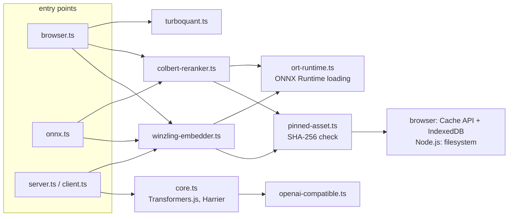

# Architecture: defuss-vectorsearch

The package embeds text, indexes the vectors as 4-bit codes and reranks candidate passages, with one API in browsers and in Node.js. It runs the models locally. It is not a vector database: it keeps no index on disk, does not serialize indexes and stores no text. Usage is in [README.md](README.md).

## Why this design

**Direct ONNX for the pinned models.** Winzling and the MoEdernColBERT reranker run on ONNX Runtime and `@huggingface/tokenizers`. They do not go through Transformers.js, which the Harrier path still uses. VERIFIED: a Vite production build of `browser.js` contains no Transformers.js, `defuss-multicore`, `onnxruntime-node` or Node.js built-in code (`scripts/test-browser-bundle.ts`). That keeps the browser entry at about 340 KB of JavaScript, plus the ONNX Runtime Web WASM.

**One reader for pinned releases.** Each pinned model names one Hugging Face commit and the SHA-256 of every file it loads. `src/pinned-asset.ts:readPinnedAsset` loads a file from the caller's `loadFile`, the cache or the network, then checks the hash before the file reaches ONNX Runtime, cache hits included. Winzling and the reranker share it, so their integrity and cache rules cannot drift apart. VERIFIED: a corrupt asset fails before a session exists (`src/colbert-reranker.test.ts`, `src/winzling.test.ts`).

**Reranking as a second stage.** The reranker produces 128-dimensional vectors per token and scores them with ColBERT MaxSim. That space is unrelated to Winzling's 384-dimensional sentence vectors, so the reranker reorders dense hits rather than replacing the index. A single-vector index cannot store per-token vectors; a separate stage leaves TurboQuant unchanged.

**Precision contracts carried into fingerprints.** The `fp32`, `q8` and `q4` graphs give the same vectors in every runtime. `fp16` and `int8` round differently per runtime, so their fingerprint names the runtime as well, and `maxSim` refuses to compare matrices with different fingerprints. VERIFIED: `src/colbert-reranker.live.test.ts` checks both rules in native Node.js CPU and WASM, and `src/colbert-reranker.live.browser.test.ts` checks them in Chromium WASM.

## How it works

- `browser.ts` binds the browser cache (`model-cache.browser.ts`: Cache API first, IndexedDB `defuss-vectorsearch-cache` as the durable copy) and allows the `wasm` device only for the reranker. `onnx.ts` binds a cache that picks the filesystem in Node.js and the browser cache in browsers.
- `ort-runtime.ts` loads `onnxruntime-node` for `device: "cpu"` and `onnxruntime-web` otherwise. ORT Web keeps `wasmPaths` and `numThreads` in one global object, so this module records the first setting and rejects a different one from any model in the package.
- `winzling-embedder.ts` and `colbert-reranker.ts` each keep one session per instance and run calls through a serial queue. `dispose()` waits for accepted work. A failed load can be retried.
- `turboquant.ts` pads vectors to a power-of-two dimension, rotates them and packs two 4-bit codes per byte. It searches the codes without rebuilding dense vectors.
- `server.ts` and `client.ts` pick a profile from the model ID: Winzling uses `winzling-embedder.ts`, Harrier uses the Transformers.js runtime in `core.ts`, and `core.ts` sends explicit endpoint requests through `openai-compatible.ts`.

## Operations

- **Configuration and policy:** all settings are constructor options. The Winzling embedder and the reranker check them in their constructors, so invalid values throw before any download. The package's own code reads two environment variables, `HF_TOKEN` and `HF_ACCESS_TOKEN`, in Node.js, in `prefetchModel` for huggingface.co requests.
- **Third-party integrations:** models download from `https://huggingface.co/<id>/resolve/<commit>/<file>` or from a mirror given as `modelBaseUrl`. ONNX Runtime Node is pinned to 1.21.0, the version Transformers.js loads, so one process never loads two native ORT libraries; ORT Web is pinned to 1.30.0.
- **Complexity and resources:** MaxSim costs query tokens times passage tokens times 128 multiply-adds per passage; a query always takes 32 positions and a passage at most 512. Winzling accepts up to 8,192 tokens, and attention memory grows with input length, so callers chunk long texts.
- **Reliability:** downloads and cache reads fail closed on an HTTP error or a hash mismatch. `allowRemoteModels: false` turns a cache miss into an error instead of a download. There is no fallback to hosted inference.
- **Observability:** the library writes no logs; it reports failures as thrown errors that name the file and the cause.

## Security and privacy

**Security.** The trust boundary is the downloaded model files: the package accepts a file only when its SHA-256 matches the hash pinned in `src/model-profiles.ts`, so a mirror or a corrupted cache cannot swap in another graph. Text inputs are checked to be strings and stay within the length limits unless the caller enables truncation. The package reads two secrets: the `apiKey` option of an OpenAI-compatible endpoint, sent as a `Bearer` header to that endpoint, and `HF_TOKEN` or `HF_ACCESS_TOKEN` in Node.js, sent only to huggingface.co and hf.co.

**Privacy.** Winzling, Harrier and the reranker process text on the local machine or in the local browser; the package sends no text anywhere unless the caller configures an OpenAI-compatible endpoint, which receives the texts to embed. The caches hold model files only. The package stores no texts, vectors or indexes, so whatever personal data a caller embeds stays under the caller's control and retention.
