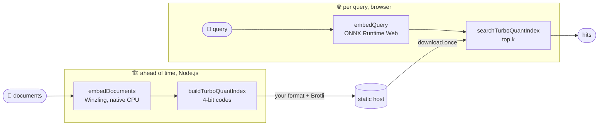
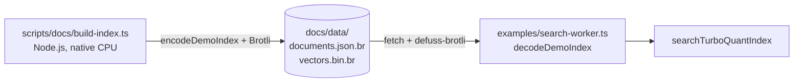

# defuss-vectorsearch

[](LICENSE)
[](package.json)
[](tsconfig.json)
[](https://vectorsearch.defuss.org)

**Vector** search for JavaScript: a multilingual embedding model of 28.81 MB to download (39.76 MB unpacked, all-in) and a 4-bit index, in the browser and in Node.js.

The Winzling embedding model runs on ONNX Runtime Web (WASM, experimental WebGPU) in the browser and on ONNX Runtime (WASM or native CPU) in Node.js, behind the same API. TurboQuant stores each vector as 4-bit codes, so 2,000 passages take 0.49 MiB instead of 2.93 MiB in float32.

## TL;DR

Build the index server-side and publish it. The browser downloads the index, embeds the search query locally and searches the TurboQuant index locally. Once the model is cached, a reload loads it in ~0.4 s; embedding a query then takes 28.8 ms and searching 2,000 passages 0.36 ms (headless Chromium, see [Quick start](#quick-start) and [Benchmark](#benchmark)).

- 🔁 **Isomorphic:** one embedder API in browsers and in Node.js; both produce the same Winzling vectors (minimum cosine 1 over 40 passages)
- 🪶 **Small model:** 28.81 MB to download as Brotli files, 39.76 MB unpacked (30.46 MB ONNX graph, 9.29 MB tokenizer), instead of 304.68 MB for Harrier, and 168 to 609 MiB of memory at runtime in Chromium 140 (eight runs)
- 🗜️ **4-bit index:** TurboQuant keeps 256 B per vector instead of 1,536 B in float32; the live demo's 2,000 passages are 412 kB as a Brotli file
- 🎯 **Multilingual recall:** R@5 of 91.0% over eight languages for the passage in the query's language (98.8% counting its translations), 96 to 98% for German, Russian and English, against a 2,000-passage haystack in 20 languages
- ⚡ **Fast queries:** 28.8 ms to embed a query, 0.36 ms to search 2,000 passages (means, Chromium, WASM, 1 thread)
- 🔒 **Pinned and checked:** one pinned model revision; every file is SHA-256 checked, cache hits included, and cached in the Cache API and IndexedDB (browser) or on the filesystem (Node.js)
- 📦 **Lean browser bundle:** `browser.js` builds to 340 KB of JavaScript plus the 26.78 MB ONNX Runtime Web WASM, with no Transformers.js or Node.js code
- 🧪 **Oracle-tested:** exact token IDs, and embeddings within `2e-5` of Rust tokenizers and Python ONNX Runtime, on 24 multilingual and adversarial cases

## How it works



The package does not serialize indexes; the live demo writes its own format (`scripts/docs/index-format.ts`, see [Patterns](#patterns)).

| Entry point | When you reach for it | What it does |
|---|---|---|
| **`browser.js`** | a browser app | Winzling embedder and MoEdernColBERT reranker cached in the Cache API and IndexedDB, TurboQuant, `normalizeVector(s)`. ESM-only. A Vite production build contains no Transformers.js, `defuss-multicore`, `onnxruntime-node` or Node built-in code. |
| **`onnx.js`** | Node.js or isomorphic code | The same Winzling embedder and reranker, with a filesystem cache in Node.js and the browser cache in browsers. Does not import Transformers.js. ESM + CJS. |
| **`server.js` / `client.js`** | Harrier, OpenAI-compatible endpoints, or one factory for several models | `createEmbeddingServer` / `createEmbeddingClient`. The no-argument factory defaults to Harrier; known model IDs select their profile. |
| **`turboquant.js`** | a small index | `buildTurboQuantIndex`, `searchTurboQuantIndex`, `searchTurboQuantIndexRerank`, `scoreTurboQuantIndex`, `rerankSearchHits`, `selfCheckTurboQuant`. |
| **`vector-search.js`** | exact (bruteforce) search | `searchTopK`, `searchTopKMulticore`, `dotProduct`, `normalizeVector(s)`, `topKFromScores`, `attachRecords`. |

## Install

```sh
bun add defuss-vectorsearch@0.4.0        # or: npm install defuss-vectorsearch@0.4.0
bun add onnxruntime-node@1.21.0          # only for device: "cpu" in Node.js or Bun
```

Tested on Node.js 22.18 or later, Bun 1.4 and headless Chromium. To work on it, see [From a checkout](#from-a-checkout).

## Quick start

### Browser: Winzling + TurboQuant

```ts
import { buildTurboQuantIndex, createWinzlingEmbedder, searchTurboQuantIndex } from "defuss-vectorsearch/browser.js";

const embedder = createWinzlingEmbedder(); // one ONNX Runtime Web session, reused for every call
const documents = ["The cat sleeps on the sofa.", "Die Börse schloss heute im Plus.", "Кошка спит на диване."];
const index = buildTurboQuantIndex(await embedder.embedDocuments(documents));
const hits = searchTurboQuantIndex(index, await embedder.embedQuery("A sleeping cat on a couch."), 2);
console.log(hits.map((hit) => documents[hit.index])); // both cat sentences
```

VERIFIED by `scripts/test-browser-bundle.ts` (part of `make e2e`) and one run against huggingface.co:

- **Auto-download and cache.** The first call downloads the pinned Winzling release from Hugging Face as Brotli `.br` files (28.81 MB), decodes them with the decoder of [defuss-brotli](https://www.npmjs.com/package/defuss-brotli) (a 185.5 kB WASM file) and checks every decoded file's SHA-256. It stores the decoded files (39.76 MB) in the Cache API and IndexedDB, so a cached start loads no decoder. A reload makes no model request: 3.7 s cold, 0.4 s warm in headless Chromium.
- **Bundle contents.** `browser.js` holds the Winzling embedder, TurboQuant search and `normalizeVector`. A Vite production build of the snippet contains no Transformers.js, `defuss-multicore`, `onnxruntime-node` or Node built-in code. It is 355 KB of JavaScript plus two WASM files Vite emits next to the bundle by itself: ONNX Runtime Web (26.78 MB) and the Brotli decoder (185.5 kB).
- **Bundlers.** Only Vite was tested. Under Vite's dev server, keep `onnxruntime-web` and `defuss-brotli` out of dependency pre-bundling (`optimizeDeps: { exclude: ["onnxruntime-web", "defuss-brotli"] }`), as this repo's `vite.config.ts` does. Pre-bundled, the decoder looks for its WASM file in Vite's cache and gets the page instead. With another bundler, pass `wasmPaths` pointing at a copy of `onnxruntime-web/dist/`, as the demo does with `"/ort/"`, and `brotliWasm` pointing at a copy of `defuss-brotli/decompressor.wasm`. `bun build` needs this, because it leaves the decoder's `new URL("./decompressor.wasm", import.meta.url)` unchanged.
- **Format.** The entry is ESM-only and accepts `device: "wasm"` (default) or `"webgpu"`.

This is the smallest and fastest setup in the [benchmark](#benchmark): 28.8 MB instead of 305 MB to download, 2.9× faster passage embedding in Chromium, and a TurboQuant index 6× smaller than float32. The benchmark holds each passage in 20 languages. In the benchmark's eight target languages (German, Russian, English, French, Dutch, Italian, Portuguese, Spanish), Winzling ranks the passage or one of its translations in the top 3 for 98.3% of queries, against 99.3% for Harrier (Node.js, bruteforce). The passage in the query's language reaches the top 3 for 84.0% of queries, against 99.0%: Winzling often ranks a translation above it. Spanish and Italian show this most, at 68% and 76% R@3, and 100% and 98% when a translation counts. When the top 3 must hold the passage in the query's language, use Harrier through `client.js`.

### Rerank dense hits with MoEdernColBERT

```ts
import { createColbertReranker } from "defuss-vectorsearch/browser.js"; // or onnx.js in Node.js

const reranker = createColbertReranker({ model: "1.5m" }); // 2.28 MB to download, cached like Winzling
const query = "A sleeping cat on a couch.";
const hits = searchTurboQuantIndex(index, await embedder.embedQuery(query), 25);
const fused = await reranker.rerankHits(query, hits, documents, { truncate: true }); // best first
console.log(fused.slice(0, 3).map((hit) => documents[hit.index]));
```

`rerankHits` reranks the top 25 dense hits and fuses the reranker's order with Winzling's (reciprocal rank fusion), so it reorders the hits of a dense search rather than replacing it. The reranker encodes the query and each passage into 128-dimensional token vectors and scores them with ColBERT MaxSim. Those vectors share no space with Winzling's, so you cannot put them in a TurboQuant index. `truncate: true` lets a query longer than 32 tokens keep its first 31 instead of throwing.

VERIFIED by `make bench` (the eight target languages; recall from `bench.json`, times from the 2026-11-08 run; Winzling's rows are identical in Node.js and Chromium, Harrier's are from Node.js):

| Pipeline | R@1 | R@3 | R@5 | R@10 | Added per query |
|---|---:|---:|---:|---:|---:|
| Winzling, TurboQuant | 67.3 | 83.0 | 91.0 | 97.0 | |
| Winzling, TurboQuant, then `rerankHits` | 78.5 | 90.3 | 95.3 | 98.0 | 93 ms in Node.js (native CPU), 167 ms in Chromium (p50) |
| Harrier, TurboQuant | 97.0 | 99.0 | 99.3 | 99.5 | |
| Harrier, TurboQuant, then `rerankHits` | 91.0 | 97.3 | 98.5 | 100.0 | 97 ms in Node.js (native CPU) |

Use the reranker with Winzling only: it is weaker than Harrier and pulls Harrier's ranking down. Chromium's Harrier rows and the per-language effect are in the [benchmark](#benchmark). Counting a translation as a hit, Winzling's R@1 rises only from 96.5 to 97.8: most of the gain is ranking the passage in the query's language above its translations.

| `model` | Hugging Face release | Download (`.br`) | Unpacked | Graph |
|---|---|---|---|---|
| `"1.5m"` | [`kyr0/winzling-embed-SauerkrautLM-MoEdernColBERT-1.5M-weight-space-programming`](https://huggingface.co/kyr0/winzling-embed-SauerkrautLM-MoEdernColBERT-1.5M-weight-space-programming) | 2.28 MB | 3.83 MB | `q8` |

`"1.5m"` is a weight edit of SauerkrautLM-MoEdernColBERT-1.5M that adds 11,998 Cyrillic tokens. It ships as `q8` only. VERIFIED in [its model card](https://huggingface.co/kyr0/winzling-embed-SauerkrautLM-MoEdernColBERT-1.5M-weight-space-programming), with exhaustive MaxSim on the upstream card's nine benchmarks:
- **Card benchmarks.** The macro nDCG@10 is +0.0015 against the original (95% CI −0.0026 to +0.0054). GermanDPR (+0.008) and GermanQuAD (+0.003) improve significantly, and no benchmark gets significantly worse.
- **Russian.** The original tokenizer maps Russian to `<unk>` and scores 0.01 to 0.16 nDCG@10 on six Russian tasks. The edit scores 0.35 to 0.86.
- **Other text.** Text without Cyrillic letters keeps its token ids.

0.4.0 dropped `"1.5m-original"` and `"27m"`, the unedited 1.5M and 27M exports: their repos serve no `.br` files. A token vector's fingerprint names the pinned commit, which moved in 0.4.0, so `maxSim` refuses to compare vectors cached with 0.3.x with new ones: re-encode cached passages.

`q8`, the only graph, stores INT8 weights and computes in FP32. Its scores match the exporter's Python ONNX Runtime within `1e-3` in native Node.js CPU, Node.js WASM and Chromium WASM.

VERIFIED by `src/colbert-reranker.live.test.ts`, `src/colbert-reranker.live.browser.test.ts` (`make test`), `scripts/test-browser-bundle.ts` (`make e2e`) and one run against huggingface.co:

- **Reference scores.** The `q8` graph runs on 6 queries against 8 passages. It stays within `1e-3` of the exporter's Python scores and keeps its top-ranked passage.
- **Auto-download and cache.** The first call downloads the `.br` of 4 files, decodes them and checks their SHA-256: from the pinned commit on huggingface.co (one Node.js run, both models) or from `modelBaseUrl`. A reload of the e2e page, which serves a local mirror, makes no reranker request.
- **Bundle contents.** The Vite build of `browser.js` with the reranker still contains no Node.js, Transformers.js or `onnxruntime-node` code.
- **Fusion.** `src/colbert-reranker.live.browser.test.ts` fuses Winzling's TurboQuant hits in Chromium and ranks each fixture query's labeled passage first.

### Node.js: Winzling only

```ts
import { createWinzlingEmbedder } from "defuss-vectorsearch/onnx.js";

const embedder = createWinzlingEmbedder({ device: "wasm" });
try {
  const documents = await embedder.embedDocuments([
    "The cat sleeps on the sofa.",
    "Die Katze schläft auf dem Sofa.",
    "Кошка спит на диване.",
  ]);
  const query = await embedder.embedQuery("A sleeping cat on a couch.");
  console.log(documents.length, query.length); // 3, 384
} finally {
  await embedder.dispose();
}
```

`onnx.js` does not import Transformers.js. The retained legacy dependencies remain in the package's installation footprint. This release does not split or remove them.

### From a checkout

Bun installs dependencies and runs scripts. Node **22.18+** executes the TypeScript (native type stripping) and the native ONNX Runtime; tested with Node 24.19.0 on Linux x64.

The package also runs on **Bun 1.4**. VERIFIED by `scripts/test-bun-consumer.ts` (part of `make e2e`) with Bun 1.4.0, 1.4.3 and 1.4.4 on macOS arm64. It packs the package, installs the tarball with `bun add` into a clean app, and runs Winzling, TurboQuant and `rerankHits` there on native CPU (`onnxruntime-node@1.21.0`) and WASM, through the ESM and the CJS entry. Bun's default refusal to run the `onnxruntime-node` postinstall does no harm: that script only fetches CUDA binaries. CI repeats the run with Bun 1.4.0 and the newest 1.4 release.

```sh
make setup                      # bun install, Playwright Chromium, build, model assets
node examples/node.ts           # CPU via ONNX Runtime Web/WASM
node examples/node.ts --cpu     # native Node CPU
bun run demo                    # open the printed localhost URL
```

`make setup` skips the optional CUDA download; the native CPU binaries ship in the `onnxruntime-node` package, so Bun's blocked postinstall for it is harmless.

The ZIP includes the exact model graph and tokenizer under `public/models/winzling/`. `models:download` validates their SHA-256 hashes; when absent, it downloads the pinned release. It also copies the installed ORT WASM/JavaScript assets into `public/ort/` for the local browser demo. The model and runtime assets are ignored by Git and excluded from the npm tarball. After dependency installation and asset preparation, the examples need no network.

Without `make` (e.g. Windows PowerShell), set `$env:ONNXRUNTIME_NODE_INSTALL_CUDA='skip'`, then run `bun install`, `bunx playwright install chromium`, `bun run build` and `bun run models:download`. A minimal Linux host needs `make setup PLAYWRIGHT_FLAGS=--with-deps`.

## Live demo

[vectorsearch.defuss.org](https://vectorsearch.defuss.org) serves `docs/index.html`, a standalone page built with defuss-shadcn from its CDN. On page load it fetches a prebuilt index of the 2,000 benchmark passages. Tabs pick the models that search, under the names the page gives them:

| Mode | Models | Download | Search |
|---|---|---:|---|
| `kyr0/Winzling-reranker` (default) | the MoEdernColBERT 1.5M reranker | 2.28 MB + 8.5 MB token vectors | the passages' token vectors, prebuilt with the index; MaxSim over all 2,000 per query (`rankEncoded`) |
| `kyr0/Winzling-embed` | Winzling | 28.8 MB | the prebuilt TurboQuant index |
| Fused | both | 31.1 MB | TurboQuant's hits at once, then their order fused with the reranker over the top 25 |

The first search downloads the chosen models with byte progress; later searches run as you type. `make docs` encodes the passages for the reranker too, so the browser downloads their token vectors (`docs/data/tokens.bin.br`) instead of encoding them; "Re-embed the index" does the encoding in the browser anyway, to show what it costs. VERIFIED (`tmp/mode-probe.ts`, Chromium, 2026-11-09): encoding the 2,000 passages there takes 16.4 s and yields 92.5 MB of float32 token vectors.

VERIFIED (`tmp/token-store-probe.ts`, the 450 queries in the nine languages the models are built for, 2026-11-09), the stored precision against download and recall:

| Token vectors | Brotli | R@1 | R@5 | R@10 |
|---|---:|---:|---:|---:|
| float32 | 85.6 MB | 68.0 | 83.8 | 86.9 |
| float16 | 42.1 MB | 68.2 | 83.8 | 86.9 |
| int8, scale per token | 21.4 MB | 68.4 | 83.8 | 86.9 |
| int4, scale per token (the demo; 8.5 MB with scales and header) | 8.2 MB | 67.3 | 83.8 | 87.3 |

The reranker alone stays slower per query than the other modes: each query scores all 180,626 token vectors, 1.1 s in Chromium (p50, `bench.json`), against 23 ms for Winzling with TurboQuant. The ⌘K palette lists the 1,000 benchmark questions by language; for those, the results mark the gold passage and its translations. A second tab is a vector database you fill yourself: each note you write is embedded in the browser 500 ms after you stop typing (or when it loses focus) into a TurboQuant index you can search right beside it. The "Use it" section gives a prompt that points a coding agent at this repository, and [`llms.txt`](https://vectorsearch.defuss.org/llms.txt) (`docs/llms.txt`) tells AI agents when to choose the package and how to use it; `scripts/test-docs.ts` checks its figures against `bench.json`.

```sh
python3 -m http.server -d docs 8080   # serves docs/ at http://localhost:8080/
make docs                            # rebuilds docs/data/ (~9 min) and docs/assets/search-worker.js
```

VERIFIED by `scripts/test-docs.ts` (part of `make e2e`), which serves the model and ONNX Runtime from the local mirrors:

- **Prebuilt index.** In Chromium, Winzling embeds a passage in 111 ms on average and a query in 21 ms (p50, `bench.json`). Indexing 2,000 passages in the browser would take about 4 minutes, so `make docs` embeds them once in Node.js. `docs/data/vectors.bin.br` holds the 4-bit TurboQuant index (0.51 MB raw, 412 kB as Brotli); `docs/data/documents.json.br` the passages and questions (318 kB as Brotli, 434 kB if gzipped). They are compressed at build time, so every host sends the same bytes, and the worker decodes them with the same defuss-brotli decoder as the model files.
- **No bundler on the page.** `examples/search-worker.ts` becomes one 294 KB file, `docs/assets/search-worker.js`. ONNX Runtime's `onnxruntime-web-use-extern-wasm` export condition keeps its WASM out of the bundle; the worker fetches it from jsDelivr at the installed version, and the model from Hugging Face. Both answer cross-origin requests.
- **Downloads on request.** Typing alone downloads nothing, and neither does choosing a mode; the chosen models download with the first search (the Search button, an example query) or "Load the model". The worker keeps their files and the token vectors in the Cache API, so switching modes and reloading the page load them from there with no model request.
- **Re-embed the index.** In the reranker mode, the button encodes all 2,000 passages again in the browser, shows the time it took, and the searches use the result.
- **Three modes.** The reranker alone reports `strategy: MoEdernColBERT MaxSim, all passages` and ranks the English example's gold passage first; Winzling alone reports `strategy: TurboQuant`; both report TurboQuant's hits, then `strategy: TurboQuant + MoEdernColBERT` with the rerank time, and the cards keep their dense similarity bars while their order changes.
- **Recall card.** One tab per mode, each with R@25, R@10, R@5 and R@1 tabs (Fused at R@25 open, the hero's figure); every bar, and the average over the eight target languages above them, is the Chromium figure in `bench.json`.
- **Steady scroll.** Picking an example query keeps the scroll position, so the re-ranked results stay in view.

## API

### `createWinzlingEmbedder(options?)`

From `browser.js` (browser cache, `device: "wasm" | "webgpu"`) or `onnx.js` (isomorphic, adds `device: "cpu"` and `cacheDir` in Node.js).

```ts
const embedder = createWinzlingEmbedder(options?);
const vectors = await embedder.embedDocuments(texts); // Float32Array[], 384 dims
const query   = await embedder.embedQuery(text);      // Float32Array
await embedder.dispose();
```

Methods: `load()`, `embed()`, `embedOne()`, `embedDocuments()`, `embedQuery()`, `embedQueries()`, `dispose()`. `load()` is optional; inference initializes lazily. Embeddings are `Float32Array`s. Empty batches return `[]`; empty strings are encoded with the model's special tokens. Query whitespace is preserved. Nonempty `instruction` or `preset` options are rejected for Winzling.

| Option | Default / behavior |
|---|---|
| `device` | `"wasm"`; `"cpu"` is Node-only; `"webgpu"` is experimental |
| `batchSize` | 8; bounded microbatches with right padding |
| `maxLength` | 8192 tokens including BOS/EOS; valid range 2–8192 |
| `truncate` | `false`; excess length throws. `true` preserves terminal EOS |
| `normalize` | `true`; per-call `normalize: false` returns the mean vector |
| `modelBaseUrl` | Optional HTTP(S) mirror of the pinned release; it serves each file as `<file>.br` ([Mirrors](#mirrors)) |
| `brotliWasm` | `defuss-brotli/decompressor.wasm` next to the decoder's module; a URL, `Response`, bytes or compiled module for bundles that do not carry it. Global: the first download's value wins |
| `loadFile` | Optional `(relativePath) => Promise<Uint8Array>` overriding all asset I/O |
| `cache` | `true`; filesystem in Node; Cache API + IndexedDB in browsers |
| `cacheDir` | Node OS temporary directory / `defuss-vectorsearch` |
| `allowRemoteModels` | `true`; `false` requires cached files unless `loadFile` is supplied |
| `wasmPaths` | ORT default; self-hosting example: `"/ort/"` |
| `numThreads` | 1; avoids a cross-origin-isolation requirement for WASM |

**Concurrency and lifecycle:** concurrent calls are serialized per instance. `dispose()` waits for accepted work, releases the session, is idempotent, and rejects subsequent inference. Initialization failures can be retried. There is no hosted-inference fallback.

**Cache keys:** the provider fingerprint identifies the preset. Include `maxLength`, `truncate`, and per-call normalization overrides in application embedding-cache keys.

### `createColbertReranker(options)`

From `browser.js` (WASM, browser cache) or `onnx.js` (adds `device: "cpu"` and `cacheDir` in Node.js).

```ts
const reranker = createColbertReranker({ model: "1.5m" });
const fused    = await reranker.rerankHits(query, hits, documents);   // FusedHit[]: { index, score, denseRank, colbertScore }
const ranked   = await reranker.rerank(query, passages, { topK: 5 }); // RerankedHit[]: { index, score }, ColBERT order only
const [q]      = await reranker.encodeQueries([query]);              // TokenMatrix
const docs     = await reranker.encodeDocuments(passages);           // TokenMatrix[], cache these per passage
const same     = rankEncoded(q, docs);                                // what rerank() returns
const order    = fuseRanks(docs.map((d) => maxSim(q, d)), { denseScores: hits.map((h) => h.score) }); // rerankHits' fusion, on cached vectors
await reranker.dispose();
```

Methods: `load()`, `fingerprint()`, `encodeQueries()`, `encodeDocuments()`, `rerankHits()`, `rerank()`, `dispose()`. The pure functions `maxSim(query, document)` and `rankEncoded(query, documents)` score `TokenMatrix` values. A query always takes 32 positions, its padding filled by `[MASK]` expansion; a passage takes up to 512. Punctuation is excluded from passage scoring.

`rerankHits(query, hits, documents, options?)` takes dense hits best first (what `searchTurboQuantIndex` and `searchTopK` return) and the texts they index. It reranks the first `candidates` hits (default 25) and returns them in fused order: reciprocal rank fusion, `1 / (60 + dense rank) + 1 / (60 + ColBERT rank)`, ties kept in dense order. With the default equal weights, two candidates in opposite orders tie. When the top dense hit's score leads the second's by `denseMargin` or more (default 0.1, on Winzling's cosine scale), the dense order stands and each hit scores `2 / (60 + dense rank)`; the ColBERT scores still come back. Rank fusion ignores how far ahead a hit is, so without this check near-equal ColBERT scores could outvote a clear dense winner. VERIFIED with the 0.2.x models: in the demo's notes, the one-word query "Bücher" had its clear Winzling winner (0.287 against 0.101) pushed to third, and on the bench fusion moved one of the 87 queries whose top hit led by 0.1 or more off rank 1. VERIFIED with the 0.3.1 models (2026-11-08): that winner leads by 0.190, and plain fusion keeps it first only through the dense tie-break; on the bench, fusion moves no gold passage onto or off rank 1 for the 80 queries above the margin. Pass `denseMargin: Infinity` to always fuse. `fuseRanks(colbertScores, { denseScores, denseMargin })` is the same fusion for callers with cached token vectors: `colbertScores[i]` and `denseScores[i]` score the dense hit at rank `i + 1`; without `denseScores` it always fuses. `rerank()` returns the ColBERT order alone; it fits candidates without a meaningful order, not dense hits.

VERIFIED: `colbertWeight` sets the reranker's share of rank fusion, from 0 to 1 (default 0.5). Scores are `2 * (1 - weight) / (60 + dense rank) + 2 * weight / (60 + ColBERT rank)`, so the default gives today's scores. A weight of 0 uses the dense ranks and 1 the ColBERT ranks. The `denseMargin` override still applies; combine `colbertWeight: 1` with `denseMargin: Infinity` for the pure ColBERT order. `fuseRanks` takes the same weight for cached vectors. An invalid weight fails before inference. The Node.js, browser and packaged-consumer tests cover weighted ordering and the unchanged default.

| Option | Default / behavior |
|---|---|
| `model` | Required: `"1.5m"` |
| `precision` | `"q8"`, the only graph |
| `device` | `"wasm"`; `"cpu"` is Node-only and needs `onnxruntime-node` |
| `batchSize` | 4 |
| `truncate` | `false`; excess length throws. `true` keeps the final `[SEP]` and sets `matrix.truncated` |
| `modelBaseUrl`, `brotliWasm`, `loadFile`, `cache`, `cacheDir`, `allowRemoteModels` | As for `createWinzlingEmbedder` |
| `wasmPaths`, `numThreads` | As for `createWinzlingEmbedder`; ORT Web holds them globally, so a second, different setting throws |

Per call, `encodeDocuments`, `rerank` and `rerankHits` accept `documentLength` (3 to 512) and `truncate`; `rerank` and `rerankHits` also accept `topK`, and `rerankHits` accepts `candidates`, `denseMargin` and `colbertWeight`. Search boxes should pass `truncate: true`: a query longer than 32 tokens otherwise throws.

**Cache keys:** each `TokenMatrix` carries `fingerprint`: model, commit and graph hash. `maxSim` refuses to compare matrices with different fingerprints. Key cached passage vectors by fingerprint, passage text and `documentLength`.

**Concurrency and lifecycle:** as for `createWinzlingEmbedder`. Each `rerank()` and `rerankHits()` call runs as one queued operation, so `dispose()` waits for it to finish.

### TurboQuant

```ts
import { buildTurboQuantIndex, searchTurboQuantIndex, searchTurboQuantIndexRerank } from "defuss-vectorsearch/turboquant.js";

const index = buildTurboQuantIndex(vectors);                // options: { clip = 3.0, seed = 0x12345678 }
const hits  = searchTurboQuantIndex(index, query, 10);      // SearchHit[]: { index, score }, best first
const { rerankedTopK } = searchTurboQuantIndexRerank(index, vectors, query, 100, 10);
```

- `buildTurboQuantIndex(vectors, options?)` pads the dimensions to the next power of two (from 384 to 512, from 640 to 1024) and packs two 4-bit codes per byte. All vectors must share one dimensionality.
- `searchTurboQuantIndex(index, query, k)` scores every code against the query without reconstructing dense vectors, then returns the top `k`.
- `searchTurboQuantIndexRerank(index, vectors, query, approximateK, rerankK)` re-scores the approximate top `approximateK` with exact dot products against the float32 `vectors` and keeps `rerankK`. It needs those vectors in memory.

`searchTopK(haystack, needle, k)` from `vector-search.js` is the exact baseline: a dot product against every vector.

### `createEmbeddingServer(options?)` / `createEmbeddingClient(options?)`

```ts
import { createEmbeddingServer, WINZLING_MODEL_ID } from "defuss-vectorsearch/server.js";

const embedder = createEmbeddingServer({
  model: WINZLING_MODEL_ID,
  device: "cpu", // use "wasm" for portable CPU execution
  winzling: { batchSize: 8 },
});
try {
  const vector = await embedder.embedQuery("Eine Suchanfrage");
  console.log(vector.length); // 384
} finally {
  await embedder.dispose();
}
```

The browser equivalent is `createEmbeddingClient` from `client.js`. Known model IDs select their profile automatically. A Winzling mirror can use `{ model: "https://example.com/models/winzling", modelProfile: "winzling" }`. The folder must contain the `.br` files of the pinned files at their original paths ([Mirrors](#mirrors)). Use `WINZLING_MODEL_ID`, `WINZLING_PROFILE`, and `SUPPORTED_MODELS` for discovery.

Winzling's `dtype: "q4"` is selected automatically; its exact graph filename is `onnx/model_uint4.onnx`. There is no external `.onnx_data` file. Arbitrary model revisions, other dtypes, and non-mean pooling are not supported by this preset.

The wrapper APIs take the `createWinzlingEmbedder` options inside `winzling: { ... }`; their existing top-level `device`, `normalize`, `cacheDir`, and `allowRemoteModels` settings are also supported. Prefer the top-level settings when using the wrapper APIs. For filesystem assets, use `winzling.loadFile`, not the legacy Transformers.js `localModelPath` option.

Legacy `prefetchModel()`, `inspectModelCache()`, and `clearModelCache()` know the Winzling asset manifest. For Winzling, `prefetchModel()` downloads the `.br` files and checks the decoded files' hashes, as inference does. Actual inference verifies all three asset hashes, including cache hits. `loadFile` bypasses this cache, so cache-management methods do not inspect an application's custom loader/storage.

### Supported models

| Model | Runtime | Pooling / queries |
|---|---|---|
| `kyr0/Winzling-Embed-a8m-64k` | Direct ONNX + `@huggingface/tokenizers` | Masked mean; unchanged, unprefixed input |
| `tss-deposium/harrier-oss-v1-270m-onnx-int8` | Existing Transformers.js pipeline | Existing last-token pooling and instruction formatting |
| `onnx-community/harrier-oss-v1-270m-ONNX` | Existing Transformers.js pipeline, `dtype: "q4"` | Existing Harrier behavior |
| `kyr0/winzling-embed-SauerkrautLM-MoEdernColBERT-1.5M-weight-space-programming` | Direct ONNX + `@huggingface/tokenizers`, through `createColbertReranker` only | Reranker: `[Q] ` and `[D] ` prefixes, MaxSim over token vectors |

The no-argument client/server factory defaults to Harrier. Explicit OpenAI-compatible endpoints and the vector-search exports are retained. See [the preserved upstream README](docs/UPSTREAM_README.md) for those APIs and historical benchmarks; those benchmark results were not reproduced for this release.

### Runtime and deployment

Native Node CPU uses `onnxruntime-node@1.21.0`, matching the retained Transformers.js dependency so two incompatible native ORT libraries are not loaded into one process. The native peer is optional; the development checkout installs it. ORT Web is pinned independently to `1.30.0` and the tokenizer to `0.2.0`. That tokenizer splits on JavaScript's whitespace, not Unicode's. For U+0085 (next line) and U+FEFF (byte-order mark), its ids would differ from those of the Rust tokenizers library. So the reranker replaces U+0085 with a space and U+FEFF with U+2060 (word joiner) before tokenizing.

The included demo runs tokenization and inference in a dedicated module Worker, serves all assets from localhost, and uses exact cosine similarity for display. Do not enable ORT's proxy-worker mode for WebGPU. The provider sets it to false. WASM paths and thread settings are global ORT configuration: use consistent settings across instances and configure other users of ORT before initialization. HTTPS or localhost is needed for browser cryptography, storage, and WebGPU APIs.

WebGPU requests require a usable adapter; absence throws instead of quietly selecting CPU. When an adapter is available, the session requests WebGPU with WASM for unsupported operators. Hardware WebGPU inference was **not verified** in this environment. CPU paths are the validated defaults. GPU token states are currently read back for pooling in TypeScript; GPU graph pooling is deferred.

8192 is the model's context limit, not a promise of low memory use at that length. Long inputs can create large attention tensors. For retrieval, chunk upstream or choose a smaller explicit `maxLength`; automatic chunking is outside this package.

## Benchmark

```sh
make bench   # downloads bench/dataset.json once (make download-bench), then writes bench.json and the tables below
```

The benchmark uses [tiny-embedding-bench-v1](https://github.com/kyr0/tiny-embedding-bench/tree/main/datasets/tiny-embedding-bench-v1):
100 Belebele passages and 50 questions, each in 20 languages, with one gold passage per question.
`download-bench` checks the file against the release's pinned SHA-256.

- **Scope.** Overall R@k and *Rank ±10%* count only queries in the eight target languages: `deu_Latn`, `rus_Cyrl`, `eng_Latn`, `fra_Latn`, `nld_Latn`, `ita_Latn`, `por_Latn`, `spa_Latn` (`TARGET_LANGUAGES` in `scripts/bench/dataset.ts`). That is 400 of the 1,000 queries. Both models are also built for Indonesian; since 0.4.0 it is reported per language only, as the only one of those nine below 98% R@25 with the fused pipeline (94%; maintainer decision, 2026-11-09). All 20 languages' passages stay in the haystack as distractors. `bench.json` keeps per-language results for all 20 languages, and its `overall` fields average all 20; the README derives the eight-language values from the per-language ones. Timing and memory cover all 2,000 passages and 1,000 queries.
- **Haystack.** All 2,000 localized passages form one index. A query also competes with the 19
  translations of its own gold passage. The target is the gold passage in the query's language,
  so R@100 measures a 5% slice of the haystack.
- **Strategies.** *Bruteforce* is a dot product of the query against every normalized passage vector:
  float32, no quantization, no ANN. *TurboQuant* scores the same vectors from the 4-bit index
  (`buildTurboQuantIndex`) without exact reranking.
- **Metrics.**
  - R@k is the share of queries whose target ranks within the top k.
  - *Any-language R@k* also counts a query as a hit when a translation of its gold passage ranks within the top k. Its gap to R@k is the share of queries whose top k holds a translation of the gold passage but not the passage in the query's language.
  - *Rank ±10%* is the share of queries where TurboQuant places the target within ±10% of its bruteforce rank. An exact rank below 10 must be matched exactly.
  - Embedding time is the mean per text, one text per call, on one warm session per model.
  - Search time is the mean per query for the top 100.
  - Passage ms per method is the passage's embedding time plus an equal share of that method's index build: normalization for bruteforce, 4-bit quantization for TurboQuant.
  - Query ms per method is the query's embedding time plus its own search time.
  - Model runtime memory is the growth in resident memory over load and embedding, measured after a forced GC, minus the embedding arrays held at that point. That is process RSS in Node.js and renderer RSS in Chromium.
  - Runtime MiB per method is the model runtime plus the exact index size. Both indexes live in one process, and their difference (0.5 to 4 MiB) is smaller than RSS noise, so it is added rather than measured.
- **Environments.**
  - Node.js runs the built package on native ONNX Runtime (`device: "cpu"`). Winzling uses 1 thread. Harrier uses ONNX Runtime's default thread count, because Transformers.js sets none.
  - Chromium runs the same build on ONNX Runtime Web (`device: "wasm"`, 1 thread) in headless Playwright. It loads the model files the Node run cached in `bench/cache/`.

<!-- bench:start -->
Generated by `make bench` on 2026-11-09 · Apple M5 Max, 18 cores, darwin arm64.
Runtimes: Node.js v26.11.1; Chromium 140.0.7339.186 headless (Playwright).

### Embedding

One text per call, warm session; model runtime = memory growth over load + embedding, without the held vectors:

| Environment | Model | Device | Load ms | Embed passage ms | Embed query ms | Model runtime MiB |
| --- | --- | --- | ---: | ---: | ---: | ---: |
| Node.js | Winzling | cpu | 237 | 58.1 (p95 183.9) | 11.7 (p95 31.1) | 234.3 |
| Node.js | Harrier | cpu | 1545 | 20.9 (p95 31.5) | 11.8 (p95 14.7) | 937.83 |
| Chromium | Winzling | wasm | 662 | 128.5 (p95 397.9) | 31.1 (p95 69.0) | 311.28 |
| Chromium | Harrier | wasm | 2442 | 343.0 (p95 476.3) | 161.1 (p95 204.5) | 352.33 |
| Node.js | MoEdernColBERT | cpu | 109 | 3.2 (p95 5.0) | 1.1 (p95 1.6) | 113.36 |
| Chromium | MoEdernColBERT | wasm | 364 | 5.6 (p95 8.9) | 1.9 (p95 2.4) | 418.05 |

### Retrieval Quality

The 8 target languages: `deu_Latn`, `rus_Cyrl`, `eng_Latn`, `fra_Latn`, `nld_Latn`, `ita_Latn`, `por_Latn`, `spa_Latn`; their 400 queries against all 2000 passages in 20 languages; R@k = % of queries whose gold passage ranks in the top k:

TurboQuant + MoEdernColBERT reorders TurboQuant's top 25 by reciprocal rank fusion with the `"1.5m"` reranker (`kyr0/winzling-embed-SauerkrautLM-MoEdernColBERT-1.5M-weight-space-programming`, q8, `rerankHits`), so its R@25 and R@100 equal TurboQuant's. MoEdernColBERT MaxSim, all passages uses that reranker alone: every passage encoded once into token vectors, each query ranked by MaxSim against all of them (`rankEncoded`).

| Environment | Model | Strategy | R@1 | R@3 | R@5 | R@10 | R@25 | R@100 | Rank ±10% |
| --- | --- | --- | ---: | ---: | ---: | ---: | ---: | ---: | ---: |
| Node.js | Winzling | bruteforce | 67.8 | 84 | 91 | 96.5 | 99.3 | 99.8 | n/a |
| Node.js | Winzling | TurboQuant | 67.3 | 83 | 91 | 97 | 99.3 | 99.8 | 90.3% |
| Node.js | Winzling | TurboQuant + MoEdernColBERT | 78.5 | 90.3 | 95.3 | 98 | 99.3 | 99.8 | n/a |
| Node.js | Harrier | bruteforce | 97.5 | 99 | 99.3 | 99.8 | 100 | 100 | n/a |
| Node.js | Harrier | TurboQuant | 97 | 99 | 99.3 | 99.5 | 100 | 100 | 98.8% |
| Node.js | Harrier | TurboQuant + MoEdernColBERT | 91 | 97.3 | 98.5 | 100 | 100 | 100 | n/a |
| Chromium | Winzling | bruteforce | 67.8 | 84 | 91 | 96.5 | 99.3 | 99.8 | n/a |
| Chromium | Winzling | TurboQuant | 67.3 | 83 | 91 | 97 | 99.3 | 99.8 | 90.3% |
| Chromium | Winzling | TurboQuant + MoEdernColBERT | 78.5 | 90.3 | 95.3 | 98 | 99.3 | 99.8 | n/a |
| Chromium | Harrier | bruteforce | 97 | 98.5 | 99.3 | 99.8 | 100 | 100 | n/a |
| Chromium | Harrier | TurboQuant | 97 | 98.8 | 99 | 99.8 | 100 | 100 | 97.5% |
| Chromium | Harrier | TurboQuant + MoEdernColBERT | 91 | 97 | 98.8 | 100 | 100 | 100 | n/a |
| Node.js | MoEdernColBERT | MaxSim, all passages | 68.3 | 81.5 | 83.8 | 87 | 89.5 | 91.5 | n/a |
| Chromium | MoEdernColBERT | MaxSim, all passages | 68.3 | 81.5 | 83.8 | 87 | 89.5 | 91.5 | n/a |

### Any-Language Recall

The same queries, but the gold passage in any of the 20 languages counts as a hit. The gap to R@k above is the share of queries whose top k holds a translation of the gold passage but not the passage in the query's language:

| Environment | Model | Strategy | R@1 | R@3 | R@5 | R@10 | R@25 | R@100 |
| --- | --- | --- | ---: | ---: | ---: | ---: | ---: | ---: |
| Node.js | Winzling | bruteforce | 96.5 | 98.3 | 98.8 | 99 | 99.5 | 100 |
| Node.js | Winzling | TurboQuant | 96.5 | 98 | 98.8 | 99 | 99.5 | 100 |
| Node.js | Winzling | TurboQuant + MoEdernColBERT | 97.8 | 98.5 | 99.3 | 99.5 | 99.5 | 100 |
| Node.js | Harrier | bruteforce | 98 | 99.3 | 99.5 | 99.8 | 100 | 100 |
| Node.js | Harrier | TurboQuant | 98 | 99.3 | 99.5 | 99.5 | 100 | 100 |
| Node.js | Harrier | TurboQuant + MoEdernColBERT | 98.8 | 99.8 | 99.8 | 100 | 100 | 100 |
| Chromium | Winzling | bruteforce | 96.5 | 98.3 | 98.8 | 99 | 99.5 | 100 |
| Chromium | Winzling | TurboQuant | 96.5 | 98 | 98.8 | 99 | 99.5 | 100 |
| Chromium | Winzling | TurboQuant + MoEdernColBERT | 97.8 | 98.5 | 99.3 | 99.5 | 99.5 | 100 |
| Chromium | Harrier | bruteforce | 98 | 99 | 99.5 | 99.8 | 100 | 100 |
| Chromium | Harrier | TurboQuant | 98 | 99.3 | 99.5 | 99.8 | 100 | 100 |
| Chromium | Harrier | TurboQuant + MoEdernColBERT | 98 | 99.8 | 99.8 | 100 | 100 | 100 |
| Node.js | MoEdernColBERT | MaxSim, all passages | 88 | 89.5 | 90.5 | 91.8 | 93.8 | 98.3 |
| Chromium | MoEdernColBERT | MaxSim, all passages | 88 | 89.5 | 90.5 | 91.8 | 93.8 | 98.3 |

### Cost per Method

Passage = embed + share of the index build; query = embed + top-100 search, plus reranking 25 candidates for TurboQuant + MoEdernColBERT; runtime = model runtime + index, plus the reranker's memory growth. For MoEdernColBERT MaxSim, all passages, passage = encoding its token vectors (the index), search = MaxSim against all of them:

| Environment | Model | Strategy | Passage ms | Query ms | Search ms mean | Index build ms | Runtime MiB | Index MiB |
| --- | --- | --- | ---: | ---: | ---: | ---: | ---: | ---: |
| Node.js | Winzling | bruteforce | 58.1 (p95 183.9) | 12.0 (p95 31.4) | 0.377 | 1.9 | 237.23 | 2.93 |
| Node.js | Winzling | TurboQuant | 58.1 (p95 183.9) | 12.1 (p95 31.5) | 0.406 | 12.8 | 234.79 | 0.49 |
| Node.js | Winzling | TurboQuant + MoEdernColBERT | 58.1 (p95 183.9) | 105.6 (p95 137.7) | 93.933 | 12.8 | 259.41 | 0.49 |
| Node.js | Harrier | bruteforce | 20.9 (p95 31.5) | 12.4 (p95 15.6) | 0.638 | 3.9 | 942.71 | 4.88 |
| Node.js | Harrier | TurboQuant | 20.9 (p95 31.5) | 12.7 (p95 16.0) | 0.867 | 23.9 | 938.81 | 0.98 |
| Node.js | Harrier | TurboQuant + MoEdernColBERT | 20.9 (p95 31.5) | 114.3 (p95 137.6) | 102.512 | 23.9 | 934.52 | 0.98 |
| Chromium | Winzling | bruteforce | 128.5 (p95 397.9) | 31.5 (p95 69.4) | 0.363 | 1.9 | 314.21 | 2.93 |
| Chromium | Winzling | TurboQuant | 128.5 (p95 397.9) | 31.5 (p95 69.5) | 0.376 | 12.6 | 311.77 | 0.49 |
| Chromium | Winzling | TurboQuant + MoEdernColBERT | 128.5 (p95 397.9) | 181.6 (p95 233.2) | 150.458 | 12.6 | 674.47 | 0.49 |
| Chromium | Harrier | bruteforce | 343.0 (p95 476.3) | 161.8 (p95 205.2) | 0.624 | 4.0 | 357.21 | 4.88 |
| Chromium | Harrier | TurboQuant | 343.0 (p95 476.3) | 161.9 (p95 205.2) | 0.806 | 27.7 | 353.31 | 0.98 |
| Chromium | Harrier | TurboQuant + MoEdernColBERT | 343.0 (p95 476.3) | 341.7 (p95 399.7) | 180.581 | 27.7 | 357.39 | 0.98 |
| Node.js | MoEdernColBERT | MaxSim, all passages | 3.2 (p95 5.0) | 670.0 (p95 710.6) | 668.835 | 0.0 | 201.56 | 88.2 |
| Chromium | MoEdernColBERT | MaxSim, all passages | 5.6 (p95 8.9) | 1089.2 (p95 1179.7) | 1087.264 | 0.0 | 506.25 | 88.2 |

### Per Language, Node.js

Target languages, best first by Winzling bruteforce; cells: R@1 / R@3 / R@5 / R@10 / R@25 / R@100; Chromium and all 20 languages are in `bench.json`:

| Language | Winzling bruteforce | Winzling TurboQuant | Winzling TurboQuant + MoEdernColBERT | Harrier bruteforce | Harrier TurboQuant | Harrier TurboQuant + MoEdernColBERT | MoEdernColBERT MaxSim, all passages |
| --- | --- | --- | --- | --- | --- | --- | --- |
| `rus_Cyrl` | 80 / 92 / 96 / 98 / 98 / 100 | 76 / 92 / 96 / 98 / 98 / 100 | 90 / 94 / 96 / 98 / 98 / 100 | 96 / 98 / 98 / 98 / 100 / 100 | 94 / 98 / 98 / 98 / 100 / 100 | 90 / 96 / 98 / 100 / 100 / 100 | 66 / 76 / 76 / 78 / 84 / 86 |
| `fra_Latn` | 78 / 82 / 90 / 96 / 100 / 100 | 78 / 84 / 90 / 96 / 100 / 100 | 82 / 92 / 94 / 98 / 100 / 100 | 98 / 100 / 100 / 100 / 100 / 100 | 98 / 100 / 100 / 100 / 100 / 100 | 86 / 94 / 98 / 100 / 100 / 100 | 56 / 68 / 72 / 78 / 82 / 84 |
| `deu_Latn` | 76 / 90 / 96 / 98 / 100 / 100 | 74 / 88 / 96 / 98 / 100 / 100 | 84 / 92 / 96 / 100 / 100 / 100 | 98 / 98 / 98 / 100 / 100 / 100 | 98 / 98 / 98 / 98 / 100 / 100 | 92 / 100 / 100 / 100 / 100 / 100 | 78 / 90 / 92 / 94 / 94 / 94 |
| `eng_Latn` | 72 / 92 / 98 / 100 / 100 / 100 | 74 / 92 / 98 / 100 / 100 / 100 | 92 / 98 / 100 / 100 / 100 / 100 | 100 / 100 / 100 / 100 / 100 / 100 | 100 / 100 / 100 / 100 / 100 / 100 | 100 / 100 / 100 / 100 / 100 / 100 | 96 / 100 / 100 / 100 / 100 / 100 |
| `nld_Latn` | 72 / 84 / 90 / 98 / 98 / 98 | 72 / 84 / 92 / 98 / 98 / 98 | 80 / 90 / 96 / 96 / 98 / 98 | 94 / 98 / 100 / 100 / 100 / 100 | 94 / 98 / 100 / 100 / 100 / 100 | 92 / 98 / 100 / 100 / 100 / 100 | 80 / 88 / 90 / 92 / 96 / 98 |
| `ita_Latn` | 60 / 76 / 90 / 96 / 100 / 100 | 58 / 74 / 90 / 98 / 100 / 100 | 64 / 82 / 92 / 100 / 100 / 100 | 96 / 100 / 100 / 100 / 100 / 100 | 96 / 100 / 100 / 100 / 100 / 100 | 84 / 94 / 96 / 100 / 100 / 100 | 54 / 62 / 66 / 76 / 78 / 86 |
| `por_Latn` | 56 / 88 / 94 / 98 / 100 / 100 | 58 / 80 / 94 / 98 / 100 / 100 | 78 / 96 / 98 / 100 / 100 / 100 | 100 / 100 / 100 / 100 / 100 / 100 | 100 / 100 / 100 / 100 / 100 / 100 | 96 / 100 / 100 / 100 / 100 / 100 | 70 / 86 / 90 / 92 / 96 / 96 |
| `spa_Latn` | 48 / 68 / 74 / 88 / 98 / 100 | 48 / 70 / 72 / 90 / 98 / 100 | 58 / 78 / 90 / 92 / 98 / 100 | 98 / 98 / 98 / 100 / 100 / 100 | 96 / 98 / 98 / 100 / 100 / 100 | 88 / 96 / 96 / 100 / 100 / 100 | 46 / 82 / 84 / 86 / 86 / 88 |

Node.js vs Chromium vectors for the same passages: Winzling min cosine 1 over 40 passages; Harrier min cosine 0.98881 over 40 passages.
<!-- bench:end -->

## Findings

`make bench` regenerates the tables above. This analysis is written by hand and cites the 2026-11-08 run.

### Index Size

VERIFIED: TurboQuant stores 5 to 6 times less than bruteforce. Bruteforce keeps a float32 vector per passage. TurboQuant keeps 4-bit codes over the dimensions padded to a power of two (from 384 to 512, from 640 to 1024). The index grows with the corpus while the model stays fixed, so the gap matters most in browsers. It decides the IndexedDB footprint, what must be downloaded or synced, and what stays resident.

| Model | Per vector, bruteforce | Per vector, TurboQuant | 2,000 passages, bruteforce (measured) | 2,000 passages, TurboQuant (measured) | 100,000 passages, bruteforce (projected) | 100,000 passages, TurboQuant (projected) |
|---|---:|---:|---:|---:|---:|---:|
| Winzling (384 dims) | 1,536 B | 256 B | 2.93 MiB | 0.49 MiB | 146.5 MiB | 24.4 MiB |
| Harrier (640 dims) | 2,560 B | 512 B | 4.88 MiB | 0.98 MiB | 244.1 MiB | 48.8 MiB |

At 2,000 passages the models' runtimes (217 to 1,105 MiB in Cost per Method) still dwarf either index.

### Download Size

VERIFIED: measured from the cached model files and from the Chromium page's network requests up to the "loaded" event. MB = 10⁶ bytes.

| Model | Model files | Of which ONNX graph | Of which tokenizer | Browser runtime WASM (uncompressed) |
|---|---:|---:|---:|---:|
| Winzling | 39.76 MB (37.92 MiB) | 30.46 MB | 9.29 MB | 26.78 MB, ONNX Runtime Web 1.30 asyncify build, self-hosted from `/ort/` |
| Harrier | 304.68 MB (290.56 MiB) | 270.14 MB | 34.54 MB | 21.60 MB, the ONNX Runtime Web build bundled with Transformers.js 3.8.1, loaded from jsDelivr |

- Hugging Face sends the model files uncompressed: no `Content-Encoding` header, and `Content-Length` equals the file size.
- A server that compresses them saves little on the graph and most of the tokenizer. Winzling's three files total 28.81 MB with `brotli -q 11`, 29.02 MB with `zstd -19` and 29.41 MB with `gzip -9` (graph 27.94 MB, tokenizer 0.86 MB with brotli).
- jsDelivr sends Harrier's runtime WASM brotli-compressed, 4.11 MB on the wire. A self-hosted `/ort/` gets the same saving only if its server compresses `.wasm` files.
- Node.js downloads only the model files. Its ONNX Runtime ships as a native npm binary.
- Winzling's sizes are fixed by its pinned revision. Harrier loads its repository's `main` branch, so its files can change.
- Node.js caches every file on the filesystem, so later loads skip the network. In headless Chromium, Transformers.js could not store Harrier's 270 MB graph in the Cache API ("Unexpected internal error"). Whether a regular browser profile keeps it between visits was not tested.

### Quality, Speed, and Caveats

**Quality.** VERIFIED: over the eight target languages, TurboQuant without reranking stays within 1 point of bruteforce at every R@k, for both models in both environments, and is sometimes slightly ahead. The largest gap is Winzling R@3 (83.0 vs 84.0, 4 of 400 queries). From R@25 on, both strategies agree for both models. Harrier keeps the gold passage within ±10% of its bruteforce rank for 97.5 to 98.8% of queries, Winzling for 90%. Counting a translation of the gold passage as a hit, bruteforce R@1 is 96.5 for Winzling and 98.0 for Harrier: most of Winzling's misses at rank 1 put a translation of the right passage first.

**Speed.** VERIFIED: TurboQuant gives no speed advantage at 2,000 passages. Its search costs about as much as bruteforce (TurboQuant against bruteforce: Winzling 0.35 vs 0.34 ms, Harrier 0.87 vs 0.56 ms in Node.js). Embedding dominates both: a query costs 11 to 144 ms end to end, and the search method changes that by about 0.3 ms at most.

**Reranking.** VERIFIED: fusing TurboQuant's top 25 with the `"1.5m"` reranker (`rerankHits`, default `denseMargin` 0.1) lifts Winzling to R@1 78.5, R@3 90.3, R@5 95.3 and R@10 98.0, from 67.3, 83.0, 91.0 and 97.0, in both environments. Any-language R@1 rises only from 96.5 to 97.8, so most of that gain is ranking the passage in the query's language above its translations. In Russian, 4 of the 5 queries it misses at rank 1 put a translation of the gold passage first (R@1 90, any-language R@1 98). For Harrier it costs accuracy: R@1 falls from 97.0 to 91.0 in both environments. R@25 and R@100 do not change, because fusion only reorders the top 25. It adds 93 ms per query in Node.js (native CPU) and 167 ms in Chromium (p50), since the reranker encodes the 25 candidates at query time. Its memory cost is not measured reliably: between the TurboQuant and the fused strategy, memory moved by −203 to +377 MiB in this run.

**Caveats.**

- VERIFIED: the memory saving holds only without exact reranking. `searchTurboQuantIndexRerank` re-scores candidates against the float32 vectors, so it needs them in memory. To keep the small footprint, use `searchTurboQuantIndex`, or store the float32 vectors elsewhere (IndexedDB, a server) and fetch only the top candidates. The benchmark measured `searchTurboQuantIndex` only, with no exact float32 reranking variant.
- VERIFIED: the evidence base is small. Overall recall rests on 400 target-language queries against 2,000 passages, so the largest TurboQuant gap above (1 point) is 4 queries, on one dataset.
- VERIFIED: Chromium's memory figures swing between runs. Winzling's runtime measured 206 MiB on 2026-10-07, then 598 and 296 MiB in two runs on 2026-10-31 and 580 and 168 MiB in two runs on 2026-11-08, with the same Chromium (140.0.7339.186) and Node.js (26.11) builds and unchanged Winzling code. With the same builds and the Winzling release pinned by 0.3.1, which keeps the graph, three runs on 2026-11-08 measured 609, 573 and 306 MiB. Read each MiB figure as one run's sample, not as a property of the model.
- VERIFIED: nothing here covers corpora larger than 2,000 passages. [docs/BENCHMARK.md](docs/BENCHMARK.md) lists the open questions for larger corpora and how to test them.

## When to use it

On the benchmark, Winzling ranks the right passage or one of its translations in the top 3 for 98.3% of queries, against 99.3% for Harrier. For the passage in the query's language, R@3 is 84.0% against 99.0%, mostly because Winzling ranks a translation first. Its download is 7.7 times smaller (39.76 MB against 304.68 MB), and TurboQuant shrinks its index 6 times.

### Use it for

- **Search on the visitor's device:** the browser embeds and searches the query itself; the live demo makes no network request during a search
- **Corpora you can index ahead of time:** the demo embeds its 2,000 passages once at build time (`make docs`) instead of in each visitor's browser, where that would take about 4 minutes, and ships them as a 412 kB index
- **German, Russian and English:** R@5 of 96, 96 and 98% for the passage in the query's language (Node.js, bruteforce); the other five target languages reach 74 to 94%. Counting a translation, all eight reach 96 to 100%
- **Hybrid search:** combined with `defuss-search`, which offers exact, phonetic and fuzzy search plus rank fusion with vector search, it covers structured and unstructured data in the browser and in Node.js

### Use something else for

- **The query's language first when the corpus also holds translations:** for the passage in the query's language, Harrier reaches R@3 99.0% against Winzling's 84.0%; use it through `client.js` or `server.js`
- **Faster search than bruteforce:** TurboQuant saves memory and download, not time, at 2,000 passages
- **Exact reranking at TurboQuant's footprint:** `searchTurboQuantIndexRerank` needs the float32 vectors in memory
- **Long documents as one vector:** the 8192-token context limit is no promise of low memory use; chunk upstream
- **Corpora beyond 2,000 passages:** recall, speed and memory there are not measured
- **GPU inference you rely on:** WebGPU on real hardware is not verified

### Key principles

1. **Embed documents and queries with the same model.** The demo's index records the model ID, revision and fingerprint its passages were embedded with, and its queries use that model.
2. **Load the model before the first query when a 28.8 MB download is acceptable.** `load()` starts the download and session; otherwise the first `embedQuery` pays for it. The live demo waits for the first search, so typing alone downloads nothing.
3. **Run the model in a Worker.** Both demos run tokenization and inference in a dedicated module Worker and post results to the page. The live demo's worker keeps only the newest pending query instead of queueing every keystroke.
4. **Reuse one embedder.** Each instance holds one ONNX Runtime session and serializes its calls; `dispose()` releases it.

## Patterns

### Prebuilt index, browser search

The live demo indexes in Node.js and searches in the browser:



`scripts/docs/index-format.ts` stores the passages and the TurboQuant header as JSON, and the signs and code bytes as one binary file. Binary instead of base64 in JSON keeps the vectors at 412 kB as Brotli instead of 442 kB. `scripts/docs/index-format.test.ts` checks the round trip.

### Model files from disk

```ts
import { readFile } from "node:fs/promises";
import { createWinzlingEmbedder } from "defuss-vectorsearch/onnx.js";

const embedder = createWinzlingEmbedder({
  device: "cpu",
  loadFile: async (file) => new Uint8Array(await readFile(`public/models/winzling/${file}`)),
});
```

`loadFile` replaces all asset I/O and returns decoded files, and the embedder still checks every file's SHA-256. `scripts/test-package.ts` runs this against both the ESM and the CJS build. In the browser, `modelBaseUrl` and `wasmPaths` serve the same purpose for a self-hosted mirror (`examples/browser-worker.ts`).

### Mirrors

A mirror (`modelBaseUrl`) serves each pinned file Brotli-compressed as `<file>.br`, as Hugging Face does; the package requests nothing else. Create the `.br` files with the [defuss-brotli](https://www.npmjs.com/package/defuss-brotli) command, in the mirror's model directory:

```sh
bunx defuss-brotli compress onnx/model_uint4.onnx tokenizer.json tokenizer_config.json          # Winzling
bunx defuss-brotli compress model_q8.onnx tokenizer.json tokenizer_config.json runtime.json     # MoEdernColBERT 1.5M
```

A missing `.br` file fails with this command in the error message. The package checks the decoded bytes, not the `.br` bytes, so any Brotli encoder works. A server may also send the `.br` files with `Content-Encoding: br`, as Vite's dev server does; the runtime then decodes them on arrival, and the package accepts bytes that already match the pin.

## What "verified" means

```sh
make verify   # lint → test → coverage → e2e; CI runs the same after `make setup`
```

- `make lint`: oxlint with `--deny-warnings`
- `make test`: the Node and Chromium regression suites, and real Winzling inference on native CPU and in the browser
- `make coverage`: the Node suite's line coverage
- `make e2e`: builds ESM/CJS/declarations, typechecks the examples and scripts against them, exercises the built package exports, builds the `browser.js` bundle and runs it in Chromium, tests the Worker demo (report in `output/`), builds the demo, rebuilds the static demo's worker and drives `docs/` in Chromium
- `make bench`: regenerates `bench.json` and the [benchmark](#benchmark) tables

Individual commands are listed in `Makefile` and `package.json`.

The checked-in oracle contains **24 multilingual and adversarial cases** made with Rust tokenizers and Python native ONNX Runtime. Tests require exact token-ID agreement and compare normalized embeddings within `2e-5` maximum absolute error, including padded batches against independently generated singleton vectors. Fixtures cover Unicode, whitespace, special tokens, empty text, and byte fallback. Other tests cover pooling, normalization, explicit truncation, corruption, initialization retry, concurrent calls, disposal, and offline browser-cache reuse.

For the reranker, a second Rust-tokenizer oracle holds the token IDs of eight texts, six of them with U+FEFF or U+0085. Tests require exact agreement for every pinned MoEdernColBERT tokenizer.

To regenerate the independent oracle:

```sh
python -m pip install -r scripts/reference-requirements.txt
python scripts/generate-reference.py
python scripts/generate-colbert-tokenizer-reference.py
```

See [source provenance](docs/SOURCE_PROVENANCE.json) and [model details and licensing](docs/MODEL.md). This verifies runtime behavior, not retrieval quality on your application's corpus.

### Deliberate limits

No automatic chunking, no hosted-inference fallback, no index serialization format in the package. The Winzling preset loads one pinned revision with `dtype: "q4"` and mean pooling only. `browser.js` is ESM-only, and Vite is the only tested bundler. WebGPU was not verified on hardware, and GPU token states are read back for pooling in TypeScript. The retained legacy dependencies stay in the installation footprint, although `onnx.js` and `browser.js` do not import Transformers.js. Implementation history lives in [CHANGELOG.md](CHANGELOG.md).

## Requirements

- **Node.js** 22.18 or later (`engines`), which runs the TypeScript examples through native type stripping; tested with Node 24.19.0 on Linux x64 and Node 24.14.0 on macOS arm64
- **Bun** 1.4.2 (`packageManager`) installs dependencies and runs the scripts
- **Native CPU in Node.js:** the optional peer `onnxruntime-node@1.21.0`
- **Browser:** tested in headless Chromium 140 (Playwright); HTTPS or localhost for browser cryptography, storage and WebGPU

## Citation

If you use defuss-vectorsearch in research or want to reference it, cite it as:

```bibtex
@misc{homberg2026defussvectorsearch,
  author       = {Homberg, Aron},
  affiliation  = {Independent Researcher},
  title        = {defuss-vectorsearch: Isomorphic Multilingual Embeddings and 4-Bit TurboQuant Vector Search for JavaScript},
  year         = {2026},
  version      = {0.4.0},
  howpublished = {\url{https://github.com/kyr0/defuss-vectorsearch}},
  note         = {MIT License}
}
```

## License

MIT, see [LICENSE](LICENSE).
